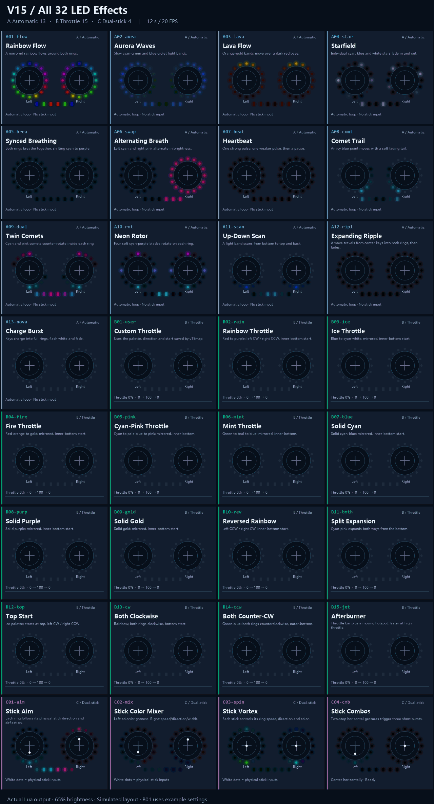

# HelloRadio V15 LED Package

[简体中文](README.zh-CN.md)

32 presets: A automatic 13 / B throttle 15 / C dual-stick 4.

Merge this directory's **SCRIPTS** into the SD card root and run v15map for first-time calibration. Keep existing layout.cfg; enable one RGB effect at a time.

- [Installation, calibration and controls](docs/en/user-guide.md)
- [Effect catalog](docs/en/effects.md)
- [All 32 GIF previews](docs/en/previews.md)

