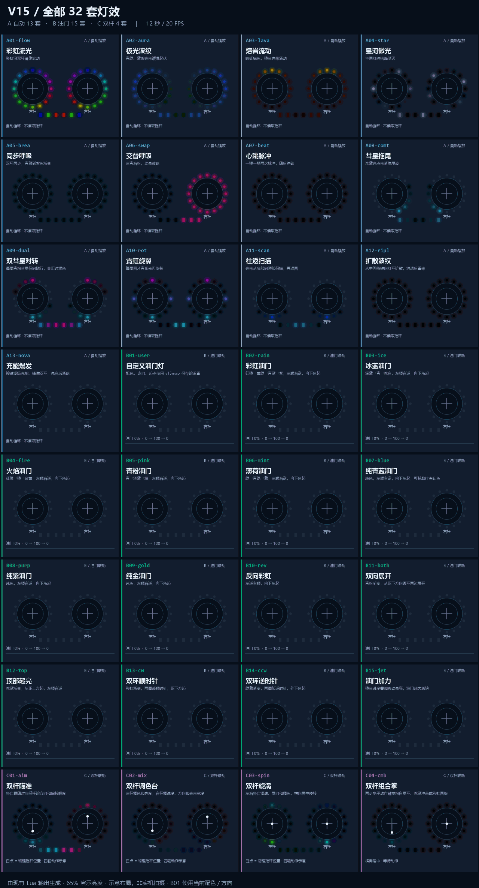

# HelloRadio V15 灯效包

[English](README.md)

32 套灯效：A 自动 13 / B 油门 15 / C 双杆 4。

把本目录的 **SCRIPTS** 合并到 SD 卡根目录，首次运行 v15map 校准。保留已有 layout.cfg，一次只启用一个 RGB 灯效。

- [安装、校准与操作](docs/zh-CN/user-guide.md)
- [灯效中文对照表](docs/zh-CN/effects.md)
- [全部 32 套 GIF](docs/zh-CN/previews.md)

